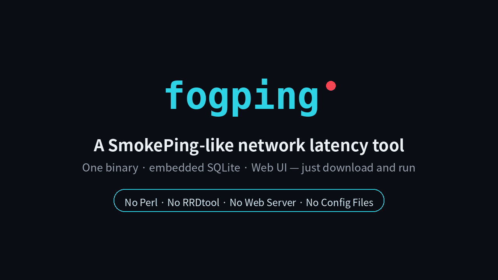

<p align="center"></p>

> ### A SmokePing-like network latency tool.
> **One binary, embedded SQLite, Web UI — just download and run.**
>
> *🚫 No Perl. No RRDtool. No Web Server. No Config Files.*





## Quick start

**Step 1 — download and start it** (Linux x86-64, one command):

```bash
mkdir -p ~/fogping && cd ~/fogping && curl -L https://github.com/githubflyideas/fogping/releases/download/v1.5.1/fogping-v1.5.1-linux-amd64.tar.gz | tar --no-same-owner -xz && ./fogping
```

**Step 2 — open it.** Go to <http://localhost:8518>. A demo target
(`www.google.com`) is already there, so your first graph appears within a
minute. There is no login yet — anyone who can reach the port can look,
which is fine for a first try. The terminal also prints the exact lines
for the next two steps, so you can copy them from there.

**Step 3 — set a login.** Stop fogping (Ctrl-C) and start it with a user
name and a password. Pick your own password — `change-me` is only an
example:

```bash
./fogping user=admin passwd=change-me
```

**Step 4 — add your own targets.** Stop it again and add `--edit` — that
one word is what allows adding, changing and deleting targets in the web
UI:

```bash
./fogping --edit user=admin passwd=change-me
```

Open the UI, click **✎ targets**, add yours. When you are done, stop it
and start again **without** `--edit` (the step 3 line): the UI turns
read-only and safe to share. Forgot the password? Nothing is stored
anywhere — just start again with a new `passwd=`.

Or with Docker (amd64 / arm64 / armv7) — the same steps apply; the words
after the image name are fogping's own, so add a login, or `--edit` and a
login, at the end when you reach those steps:

```bash
docker run -d --name fogping --restart unless-stopped -p 8518:8518 -v fogping_data:/data githubflyideas/fogping:latest
```

## Multi-point monitoring

One fogping measures from one place. To watch the same services **from
several locations**, run one fogping per location and let **Zabbix**
pull them together — no master/slave pairing to configure: Zabbix polls
each fogping's read-only stats endpoint once a minute and does the
aggregation, dashboards and alerting. **[A complete worked example —
three sites, every step](docs/ZABBIX.md)**.

## Going live

Everything below is a ready-made line — copy it as printed (with your own
password in place of `change-me`):

| I want to… | Run |
|---|---|
| Try it, no login | `./fogping` |
| Require a login | `./fogping user=admin passwd=change-me` |
| Several users | `./fogping user=alice,bob passwd=alice-pw,bob-pw` |
| Edit targets | `./fogping --edit user=admin passwd=change-me` |
| Keep 30 days of history (default and max 93) | `./fogping --days=30 user=admin passwd=change-me` |
| Listen on 127.0.0.1 only (behind a proxy) | `./fogping --localhost` |
| Run in the background | `nohup ./fogping user=admin passwd=change-me >> fogping.log 2>&1 &` |
| Check a setup before (re)starting: flags, login, data, port, plugins | `./fogping --check user=admin passwd=change-me` |
| Make a Zabbix token (file mode 600, never printed) | `./fogping --gen-token=zabbix.token` |
| Show all commands | `./fogping --help` |

Arguments can come in any order; the port is always 8518. Every start logs a short
security summary (where it listens, login, editing, Zabbix, plugins); anything exposed
is marked `!`.

**Compare:** the **COMPARE** menu under the chart overlays the previous period, yesterday or last week as a dashed median line.

**Export / import targets:** ✎ targets → ⇩ export / ⇧ import… moves a target list as a JSON file, shared with pingping — see [the guide](docs/GUIDE.md#export-and-import) and the [format spec](docs/targets-format.md).

> **PING shows 100% loss?** Allow unprivileged ICMP once:
> `echo 'net.ipv4.ping_group_range = 0 2147483647' | sudo tee /etc/sysctl.d/99-fogping.conf && sudo sysctl --system`
> (TCP targets need nothing.) Other options are in the [guide](docs/GUIDE.md#allow-icmp-ping-without-root).

## More

Everything else lives in the **[full guide](docs/GUIDE.md)**:
[multi-point monitoring with Zabbix](docs/ZABBIX.md) ·
[Docker details](docs/GUIDE.md#docker) ·
[systemd service](docs/GUIDE.md#run-as-a-systemd-service) ·
[reverse proxy](docs/GUIDE.md#behind-a-reverse-proxy) ·
[managing targets](docs/GUIDE.md#managing-targets) ·
[data & backup](docs/GUIDE.md#data-retention-and-backup) ·
[reading the chart](docs/GUIDE.md#reading-the-chart) ·
[upgrading](docs/GUIDE.md#upgrading) ·
[troubleshooting](docs/GUIDE.md#troubleshooting) ·
[HTTP API](docs/API.md) ([OpenAPI 3.1](docs/openapi.yaml)) ·
[build from source](docs/GUIDE.md#build-from-source)

🌐 [English / 中文 / Español / Français / Português / Deutsch / Русский / 日本語 / 한국어 / Bahasa Indonesia / Tiếng Việt / العربية / हिन्दी / বাংলা / اردو / Türkçe / ไทย](docs/LANGUAGES.md)

---

Friendly link: [SmokePing](https://github.com/oetiker/SmokePing) ·
Sibling project: [pingping](https://github.com/githubflyideas/pingping) (the same oscilloscope without cgo) ·
[⭐ Star](https://github.com/githubflyideas/fogping) ·
[GitHub Sponsors](https://github.com/sponsors/githubflyideas)

License: Apache 2.0
