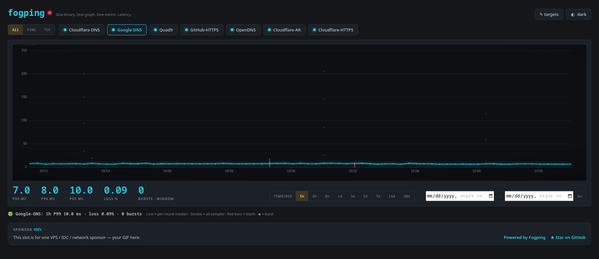
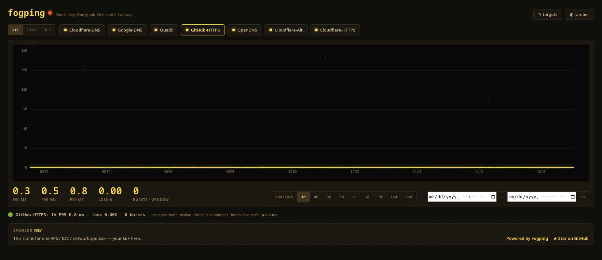
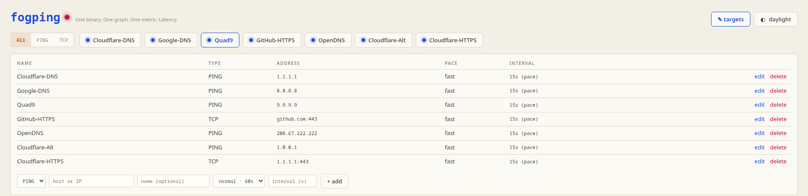

> ### A SmokePing-like network latency tool.
> **One binary, embedded SQLite, Web UI — just download and run.**
>
> *🚫 No Perl. No RRDtool. No Web Server. No Config Files.*





## Quick start

One command (Linux x86-64) — downloads, unpacks and starts fogping:

```bash
mkdir -p ~/fogping && cd ~/fogping && curl -L https://github.com/githubflyideas/fogping/releases/download/v1.1.3/fogping-v1.1.3-linux-amd64.tar.gz | tar -xz && ./fogping --edit user=admin passwd=change-me
```

Or with Docker (amd64 / arm64 / armv7):

```bash
docker run -d --name fogping --restart unless-stopped -p 8518:8518 -v fogping_data:/data githubflyideas/fogping:latest --edit user=admin passwd=change-me
```

Then open <http://localhost:8518>, log in, and watch your first puff of network smoke.
A demo target (`www.google.com`) is already there; click **✎ targets** to add your own.

## Going live

`--edit` lets you add, change and delete targets in the web UI. When you are done,
press Ctrl-C and restart **without** `--edit` — the UI becomes read-only and safe to share:

```bash
./fogping user=admin passwd=change-me
```

| I want to… | Run |
|---|---|
| Try it, no login | `./fogping` |
| Require a login | `./fogping user=admin passwd=change-me` |
| Several users | `./fogping user=alice,bob passwd=alice-pw,bob-pw` |
| Edit targets | `./fogping --edit user=admin passwd=change-me` |
| Keep 90 days of history (default 40) | `./fogping --days=90 user=admin passwd=change-me` |
| Listen on 127.0.0.1 only (behind a proxy) | `./fogping --localhost` |
| Run in the background | `nohup ./fogping user=admin passwd=change-me >> fogping.log 2>&1 &` |
| Show all commands | `./fogping --help` |

Arguments can come in any order; the port is always 8518.

**Export / import targets:** ✎ targets → ⇩ export / ⇧ import… moves a target list as a JSON file, shared with pingping — see [the guide](docs/GUIDE.md#export-and-import) and the [format spec](docs/targets-format.md). Ready-made lists: see presets/ (coming).

> **PING shows 100% loss?** Allow unprivileged ICMP once:
> `echo 'net.ipv4.ping_group_range = 0 2147483647' | sudo tee /etc/sysctl.d/99-fogping.conf && sudo sysctl --system`
> (TCP targets need nothing.) Other options are in the [guide](docs/GUIDE.md#allow-icmp-ping-without-root).

## More

Everything else lives in the **[full guide](docs/GUIDE.md)**:
[Docker details](docs/GUIDE.md#docker) ·
[systemd service](docs/GUIDE.md#run-as-a-systemd-service) ·
[reverse proxy](docs/GUIDE.md#behind-a-reverse-proxy) ·
[managing targets](docs/GUIDE.md#managing-targets) ·
[data & backup](docs/GUIDE.md#data-retention-and-backup) ·
[reading the chart](docs/GUIDE.md#reading-the-chart) ·
[upgrading](docs/GUIDE.md#upgrading) ·
[troubleshooting](docs/GUIDE.md#troubleshooting) ·
[build from source](docs/GUIDE.md#build-from-source)

🌐 [English / 中文 / Español / Français / Português / Deutsch / Русский / 日本語 / 한국어 / Bahasa Indonesia / Tiếng Việt / العربية / हिन्दी / বাংলা / اردو / Türkçe / ไทย](docs/LANGUAGES.md)

---

Friendly link: [SmokePing](https://github.com/oetiker/SmokePing) ·
Sibling project: [pingping](https://github.com/githubflyideas/pingping) (the same oscilloscope without cgo) ·
[⭐ Star](https://github.com/githubflyideas/fogping) ·
[GitHub Sponsors](https://github.com/sponsors/githubflyideas)

License: Apache 2.0
